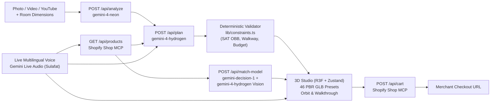

# SpatioVerse

**Multimodal 3D Room & Retail Layout Studio powered by Gemini 4, Decisions API, Gemini Live Audio, and Shopify Shop MCP.**

SpatioVerse lets merchants and designers scan an existing room via video, photo, or YouTube clip, preserve owned furniture at `$0` spend, explore and edit a constraint-checked 3D space interactively or by live voice, visually match real Shopify products onto 3D PBR assets, and generate buyer-controlled merchant checkout links.

---

## Architecture & Gemini Model Stack

SpatioVerse separates multimodal perception, structured spatial planning, calibrated model selection, real-time voice interaction, deterministic geometry validation, and live commerce into auditable services communicating through a single Zod-validated `ShopScene` contract (`lib/schema.ts`).



| Layer | Model / Service | Endpoint | Responsibility |
| --- | --- | --- | --- |
| **Multimodal Space Intake** | `gemini-4-neon` | `POST /api/analyze` | Analyzes uploaded `JPG`/`PNG`/`WebP`/`MP4`/`MOV`/`WebM` media (inline ≤14 MB or Gemini Files API) or YouTube URLs to extract existing fixtures and initial 3D spatial layout cues. |
| **Layout Planning & Swap Engine** | `gemini-4-hydrogen` | `POST /api/plan`, `POST /api/replace` | Generates constraint-checked `ShopScene` layouts (with at most 1 repair pass), executes text/voice add & replace commands, and powers full-room style/budget redesigns. |
| **Product Image → 3D Asset Matcher** | `gemini-decision-1` + `gemini-4-hydrogen` Vision | `POST /api/match-model` | Uses `v1beta/decisions` (`gemini-decision-1`) for calibrated category routing, then `gemini-4-hydrogen` Vision to inspect the actual Shopify product photo, pick the closest of 46 PBR `.glb` presets, and sample dominant color/albedo. |
| **Live Multilingual Voice Partner** | `gemini-3.1-flash-live-preview` (`Sulafat`) | `POST /api/voice/token`, `POST /api/voice/command` | Real-time bidirectional voice (English, Hindi, Hinglish, and other languages) with translucent 3D edit previews, multi-layout suggestions, consultative redesign, Shopify browsing, and checkout handoff. |
| **Deterministic Constraint Engine** | Pure TypeScript (`lib/constraints.ts`) | Client + Server | Exact 2D Separating Axis Theorem (SAT) rotated-OBB collision checks, room bounds, 3 ft (`0.9144 m`) doorway & BFS walkway clearance, `noDrilling` enforcement, and integer-cent budget validation. |
| **Live Commerce** | Shopify Shop MCP (`https://mcp.shop.com/`) | `GET /api/products`, `POST /api/cart` | Live catalog search, variant inspection, and per-merchant cart creation (`MCP-Protocol-Version: 2026-07-28`). |

---

## Feature Walkthrough

### 1. Multimodal Space Capture & Room Setup
- Open **Scan Space** (`MediaIntakeModal`) or the **Setup Wizard** (`SetupWizard`) to upload a room photo/video, record live camera clips, or paste a YouTube walkthrough URL.
- Confirm room dimensions (`width × depth × height` in feet), entrance wall, new-purchase budget, and landlord rules (`noDrilling`).
- `POST /api/analyze` (`gemini-4-neon`) detects existing fixtures and emits explicit uncalibrated-dimension warnings until confirmed; `POST /api/plan` (`gemini-4-hydrogen`) builds and validates the 3D scene.

### 2. Interactive 3D Studio & 46-Asset PBR Catalog
- Switch between **Orbit** and **First-Person Walkthrough** (`WASD` / arrow keys with live mini-floorplan HUD).
- Select, drag, rotate, lock, or remove any fixture with real-time deterministic constraint feedback (`OUT_OF_BOUNDS`, `COLLISION`, `BLOCKED_PATH`, `NO_DRILLING`, `OVER_BUDGET`, `UNVERIFIED_DIMENSIONS`).
- Renders **46 CC0 PBR `.glb` models** (`public/models/`) covering sofas, daybeds, armchairs, dining/office chairs, stools, benches, round & rectangular tables, desks, wardrobes, cabinets, dressers, nightstands, shelves, racks, beds, lamps, mirrors, and plants.

### 3. Prompt Bar & Shopify Product Add / Replace
- **Bottom Prompt Bar (`ReplaceObjectBar`):** Type or speak natural commands to swap a selected object or click **`+ Add`** to insert a new 3D item into an open floor spot.
- **Shop Products Side Panel (`ProductPanel`):** Search live Shopify inventory, inspect variants and pricing, and click **`Replace in 3D scene`** or **`+ Add`** on any product card.
- Every selected Shopify product triggers `POST /api/match-model` (`gemini-decision-1` + `gemini-4-hydrogen` Vision) to automatically hot-swap the 3D mesh and color tint to match the product's actual photograph.
- Owned items always count as `$0` toward the new-purchase budget; only Shopify items count against `budgetCents`.

### 4. Live Multilingual Voice Mode
Click the voice control to start a live session (`Sulafat` voice) or use the typed multilingual command fallback:
- **Precision Spatial Editing:** *"Move the sofa a bit to the left"*, *"Rotate the counter sideways"*, *"Stop there"*, *"Keep it"*, *"Cancel"*, *"Undo"*. Edits appear as translucent 3D previews before committing.
- **Multi-Layout Previews & Proactive Advisor:** *"Show me a few ways to arrange this room"* generates up to 3 validated layouts (`1`, `2`, `3`) using existing furniture; *"Show me the second one"* previews it live.
- **Whole-Room Clear & Consultative Style Redesign:**
  - *"Clear all objects"* or *"Remove everything except the sofa"* (1-step undoable).
  - *"Redesign my room"* prompts 1–2 quick design questions (style, kept items, budget), or speak directly: *"Give me a minimalist look under \$800"* / *"Make it decorative and cozy"*. Fetches live in-budget Shopify products and plans a fresh constraint-validated layout via `POST /api/plan`.
- **Voice Shopify Browsing & Ordering:**
  - *"Show me round walnut tables on Shopify"* opens the right-hand **Shop Products** side panel with numbered `#1`, `#2`, `#3` cards and reads out top real options.
  - *"Add the first one"* or *"Replace the table with number 2"* places it in 3D with vision-matched geometry.
  - *"Place an order for the first one"* or *"Checkout my cart"* calls `POST /api/cart` and opens the merchant checkout link card in the side panel for buyer-approved checkout.

---

## Local Setup & Running

### Prerequisites
- **Node.js** `20+` (`22+` recommended)
- **npm** `10+`
- A Google Gemini API key with access to Gemini 4 and Gemini Live models

### 1. Install Dependencies
```bash
npm install
```

### 2. Configure Environment Variables
Copy `.env.example` to `.env.local` and set your server-side API key (never commit `.env.local` or expose secrets with `NEXT_PUBLIC_`):

```bash
cp .env.example .env.local
```

```env
# Required — used server-side by /api/analyze, /api/plan, /api/replace, /api/match-model, and /api/voice/*
GEMINI_API_KEY=your_gemini_api_key_here
```

### 3. Run the Development Server
```bash
npm run dev
```
Open `http://localhost:3000`. Two offline-ready demo scenes (`flagshipScene` and `compactDemoScene`) load immediately without requiring an initial upload.

### 4. Production Build & Start
```bash
npm run build
npm run start
```

---

## Verification & Testing

Run type-checking, linting, and the automated Vitest suite (40 tests across spatial constraints, Gemini API contracts, and voice editing):

```bash
npx tsc --noEmit
npm run lint
npm test
```

| Test Suite | Coverage |
| --- | --- |
| `lib/constraints.test.ts` | Core deterministic geometry, SAT collisions, walkway BFS, budget & no-drilling checks |
| `tests/constraints.test.ts` | 8 end-to-end small-store evaluation scenarios from `fixtures/eval-cases.json` |
| `app/api/analyze/analyze.test.ts` | `/api/analyze` (inline, Files API, YouTube), `/api/plan` (1-pass repair), and `/api/replace` contracts |
| `tests/voice-editing.test.ts` | Camera-relative moves, wall alignment, stale-epoch guards, layout previews, and undo stack |

---

## API Reference

| Route | Method | Description |
| --- | --- | --- |
| `/api/analyze` | `POST` | Multimodal media intake (`multipart/form-data` or YouTube JSON) via `gemini-4-neon` |
| `/api/plan` | `POST` | Constraint-validated `ShopScene` planner with max-1 repair pass via `gemini-4-hydrogen` |
| `/api/replace` | `POST` | Natural-language / voice 3D object add, replace, or remove via `gemini-4-hydrogen` |
| `/api/match-model` | `POST` | Product image → 46-asset `.glb` & dominant color matcher via `gemini-decision-1` + `gemini-4-hydrogen` |
| `/api/voice/token` | `POST` | Issues short-lived ephemeral auth tokens for Gemini Live Audio sessions |
| `/api/voice/command` | `POST` | Typed multilingual voice-command fallback returning structured `VoiceAction[]` |
| `/api/products` | `GET` | Live Shopify Shop MCP catalog search (`?q=...&maxPrice=...`) and variant lookup (`?productId=...`) |
| `/api/cart` | `POST` | Per-merchant Shopify cart creation (`lookup_catalog` + `create_cart`) with truthful fallback URLs |

---

## Repository Structure

```text
app/
  page.tsx                       # Main 3D Studio, inspector drawer, Shop panel & HUD
  api/
    analyze/route.ts             # gemini-4-neon media analysis
    plan/route.ts                # gemini-4-hydrogen layout planner + repair
    replace/route.ts             # gemini-4-hydrogen add/replace engine
    match-model/route.ts         # gemini-decision-1 + Vision GLB matcher
    voice/token/route.ts         # Ephemeral Gemini Live token endpoint
    voice/command/route.ts       # Typed multilingual voice fallback
    products/route.ts            # Shopify Shop MCP catalog search
    cart/route.ts                # Shopify Shop MCP per-merchant cart handoff
components/
  SpaceCanvas.tsx                # React Three Fiber canvas, lighting & controls
  SceneObject.tsx                # 46-model GLB renderer, auto-axis alignment & color tinting
  BoutiqueEnvironment.tsx        # Room shell, flooring, entrance & grid
  FirstPersonRig.tsx             # Walkthrough camera controller
  MediaIntakeModal.tsx           # Photo / video / camera / YouTube intake modal
  SetupWizard.tsx                # 4-step guided room & inventory wizard
  ProductPanel.tsx               # Live Shopify browser, + Add / Replace & checkout cards
  ReplaceObjectBar.tsx           # Prompt & voice add/swap bar
  VoiceRoomControl.tsx           # Live multilingual voice HUD & layout preview controls
lib/
  schema.ts                      # Canonical Zod & TypeScript ShopScene contract
  constraints.ts                 # Deterministic SAT, walkway, budget & no-drilling validator
  gemini.ts                      # Server-side Gemini 4 & Decisions API orchestration
  modelCatalog.ts                # 46 CC0 PBR GLB asset registry & color extraction
  shopify.ts                     # Shopify Shop MCP JSON-RPC 2.0 client
  voiceActions.ts                # VoiceAction schemas & multilingual system prompt
  voiceExecutor.ts               # Deterministic + async voice tool executor
  voiceLiveClient.ts             # Gemini Live WebSocket audio & tool-call client
  layoutSuggestions.ts           # Multi-layout generator & proactive room advisor
store/
  useSceneStore.ts               # Zustand scene, undo stack, voice preview & shop state
public/models/                   # 46 CC0 PBR .glb furniture assets
fixtures/                        # Offline demo scenes & 8 constraint eval cases
tests/                           # Vitest constraint & voice editing suites
```

---

## Engineering Guardrails

- **Spatial Honesty:** Uncalibrated single-camera video/photos cannot yield millimeter-exact dimensions; `/api/analyze` flags approximate measurements (`UNVERIFIED_DIMENSIONS`) until confirmed by the user.
- **Deterministic Geometry:** Bounds, rotated-OBB collisions, walkway clearances, and budget totals are computed in local TypeScript (`lib/constraints.ts`)—never delegated to an LLM.
- **Buyer-Controlled Commerce:** SpatioVerse never fabricates product IDs, prices, or checkout links, and never auto-completes checkout (`complete_checkout` is intentionally unused); all orders hand off to official merchant carts for buyer review.

---

## Team SpatioVerse

Built for the **Gemini 4 NYC Hackathon (November 21, 2026)** by **Tilak Bhansali**, **Akarsh Malik**, **Mansi Rank**, and **Divyansh**.
