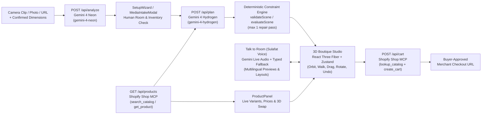

# SpaceStage — Multimodal 3D Retail Studio, Live Multilingual Voice Editor & Shopify Fixture Commerce

**Team SpatioVerse** · Gemini 4 NYC Hackathon (November 21, 2026)  
**Team:** Tilak Bhansali (3D Boutique Studio, Interactions & UI Integration) · Akarsh Malik (Gemini 4 Hydrogen/Neon APIs & Deterministic Constraint Engine) · Mansi Rank (Shopify Shop MCP Commerce & Onboarding UI) · Divyansh (Evaluation Benchmark, Live Multilingual Voice Mode & Documentation)

> **One-Line Pitch:** A small retailer can scan their space, keep the fixtures they already own, preview and rearrange a constraint-checked store in interactive 3D—by mouse or live multilingual voice—and buy only the missing pieces from real Shopify merchants without hiring a store designer.

---

## 1. Business Case & Reference Scenario

Independent merchants opening a compact boutique, pop-up shop, or market booth face tight budgets, strict landlord lease rules (such as no wall drilling), and existing millwork they need to reuse. Ordering new display tables, shelves, racks, or lighting without verifying physical walkways and total spend leads to expensive layout mistakes.

**SpaceStage** turns casual space media + confirmed room dimensions into an editable, deterministically validated, shoppable 3D store:

| Parameter | Reference Demo Scenario (`compactDemoScene`) |
| --- | --- |
| **Store Type** | Compact neighborhood skincare & apothecary boutique |
| **Confirmed Room Envelope** | `12 ft × 10 ft × 9 ft` (`3.6576 m × 3.0480 m × 2.7432 m`), south entrance (`3 ft` / `0.9144 m` wide) |
| **Owned Inventory ($0 spend)** | `1` checkout counter + `1` natural oak wall shelf (`source: 'owned'`, contributes `$0` toward purchase budget) |
| **New-Purchase Budget** | `$400.00` (`40000` cents, excluding shipping/tax) |
| **Hard Physical Constraints** | Room envelope bounds, zero 2D SAT rotated-footprint overlaps, continuous `3 ft` (`0.9144 m`) entrance & interior walkway, `noDrilling: true` |
| **Commerce Channel** | Live Shopify product search, variant selection, product-faithful 3D swap, and buyer-approved merchant cart handoff via official Shop MCP |

### Hackathon Track Alignment
- **Element 119 (Primary):** Multimodal camera/video input + human-confirmed dimensions → persistent, interactive 3D retail environment (`ShopScene`) with live voice & direct manipulation.
- **Two Separate Gemini 4 Models (Non-Negotiable):** `gemini-4-neon` (`POST /api/analyze`) and `gemini-4-hydrogen` (`POST /api/plan`) handle distinct, observable stages in the core pipeline.
- **Shopify Bonus Track (Secondary):** Live catalog search, variant/price inspection, and per-merchant cart handoff via `https://mcp.shop.com/`.

---

## 2. System Architecture & Shared Spatial Contract

All workstreams live in one **Next.js 16 App Router (TypeScript)** codebase and communicate through the canonical `ShopScene` contract in [`lib/schema.ts`](lib/schema.ts).



### Non-Negotiable Spatial & Commerce Conventions (`lib/schema.ts`)
- **Meters & Centered Floor:** All internal lengths are in **meters** (`FT_TO_METERS = 0.3048`), `Y` is vertical up, and the floor lies on `X/Z` at `Y = 0` centered at `(0, 0)`:
  - `X ∈ [-room.width / 2, +room.width / 2]` (west → east)
  - `Z ∈ [-room.depth / 2, +room.depth / 2]` (north → south)
  - `Y ∈ [0, room.height]`
- **Object Pose & Size:** `position: [x, y, z]` (`x, z` footprint center; `y = 0` on floor), `size: [width, height, depth]` at `rotationY = 0`, `rotationY` in counter-clockwise radians around `+Y`.
- **Budget Math:** Prices are integer `priceCents`. Fixtures with `source: 'owned'` always contribute `0` cents toward `budgetCents`.
- **Renderer Isolation:** The React Three Fiber canvas renders validated `ShopScene` JSON—never raw LLM text. Floor-plane dragging, rotation, and layout previews run local deterministic validation at interactive frame rates.

### Repository File Map

| Path | Responsibility |
| --- | --- |
| `lib/schema.ts` | Canonical Zod & TypeScript schemas (`ShopScene`, `SceneObject`, `ProductRef`, `ConstraintIssue`, `SceneValidator`) |
| `fixtures/demoScene.ts` | Offline-ready `flagshipScene` (`24×18 ft`, `$1,200` budget) and `compactDemoScene` (`12×10 ft`, `$400` budget) |
| `fixtures/eval-cases.json` | `8` independent small-store evaluation scenarios in centered meters |
| `lib/gemini.ts`, `app/api/analyze/route.ts`, `app/api/plan/route.ts` | Server-side `@google/genai` integrations for `gemini-4-neon` (media intake) and `gemini-4-hydrogen` (layout planning + 1-pass repair) |
| `lib/constraints.ts` | Deterministic 2D SAT rotated-OBB collision, room bounds, BFS `3 ft` continuous walkway, `noDrilling`, `UNVERIFIED_DIMENSIONS`, and budget validator |
| `lib/shopify.ts`, `app/api/products/route.ts`, `app/api/cart/route.ts` | Official Shopify Shop MCP JSON-RPC 2.0 client (`2026-07-28`), variant normalization & merchant-grouped cart handoff |
| `app/page.tsx`, `components/SpaceCanvas.tsx`, `components/BoutiqueEnvironment.tsx`, `components/SceneObject.tsx`, `components/FirstPersonRig.tsx`, `components/SceneToolbar.tsx`, `lib/productVisuals.ts`, `lib/textures.ts`, `lib/modelCatalog.ts` | Interactive 3D boutique studio, GLB + parametric PBR fixtures, product-faithful finish/style swaps, orbit & `WASD` walkthrough modes |
| `components/SetupWizard.tsx`, `components/MediaIntakeModal.tsx`, `components/ProductPanel.tsx` | Camera/video/photo onboarding, measurement confirmation, and live Shopify SKU replacement & cart drawer |
| `components/VoiceRoomControl.tsx`, `lib/voiceLiveClient.ts`, `lib/voiceActions.ts`, `lib/voiceExecutor.ts`, `lib/layoutSuggestions.ts`, `lib/cameraBridge.ts`, `app/api/voice/token/route.ts`, `app/api/voice/command/route.ts` | Live multilingual voice-editing mode (`Sulafat` US female voice), animated translucent 3D previews, up to 3 validated layout options with SVG thumbnails, proactive post-drag room advisor, and undo |
| `store/useSceneStore.ts` | Zustand store managing `ShopScene`, validation issues, undo stack, active voice/layout previews, and `localStorage` persistence |
| `tests/constraints.test.ts`, `tests/voice-editing.test.ts`, `lib/constraints.test.ts`, `app/api/analyze/analyze.test.ts` | `38` automated Vitest tests covering spatial constraints, Gemini API contracts, and multilingual voice/layout workflows |

---

## 3. Model Roles & Live Voice Architecture

SpaceStage uses dedicated Gemini models for distinct tasks, keeping all long-lived API keys strictly server-side:

| Component | Model ID / Endpoint | Role in SpaceStage | Key Guardrails |
| --- | --- | --- | --- |
| **Scene Observation** | `gemini-4-neon` (`POST /api/analyze`) | Multimodal observation of uploaded `JPG`/`PNG`/`WebP` images, `MP4`/`WebM`/`MOV` clips (inline `<14 MB` or Gemini Files API up to `100 MB`), or YouTube URLs. Benchmarked at `~10.5s` with `3/3` fixture recall and `0` false positives. | **Never** asserts exact room/object dimensions from uncalibrated video; emits measurement warnings for user confirmation. *(Overridable via `ANALYZE_MODEL_ID`.)* |
| **Spatial Layout Planner** | `gemini-4-hydrogen` (`POST /api/plan`) | Generates `ShopScene` JSON from confirmed dimensions, owned inventory, style, `budgetCents`, `minWalkwayWidth`, `noDrilling`, and real `ProductRef[]` candidates (`~10.8s` layout, `~6.3s` repair). | Preserves owned items at `$0`; strips any invented product variant IDs; runs **at most 1** repair pass from `evaluateScene` errors. *(Overridable via `PLAN_MODEL_ID`.)* |
| **Live Multilingual Voice Session** | `gemini-3.1-flash-live-preview` (`POST /api/voice/token` → WebSocket, fallback `gemini-2.5-flash-native-audio-latest`) | Full-duplex voice editing with Gemini's **`Sulafat`** warm General American female voice, streaming 16 kHz mic audio + live canvas JPEG frames, instant barge-in interruption, and natural multilingual / Hinglish code-switching. | Connects with short-lived server-minted ephemeral tokens (`auth_tokens/...`); executes typed tools against `validateScene` rather than raw coordinate text. |
| **Typed Multilingual Command Fallback** | `gemini-3.8-flash` (`POST /api/voice/command`) | Handles typed room commands in any language with `anyOf` constrained JSON decoding when microphone access is unavailable or text input is preferred. | Drives the exact same typed `VoiceAction` executor, translucent 3D preview, layout options, and undo stack. |
| **Deterministic Spatial Verifier** | Local TypeScript (`lib/constraints.ts`) | Enforces bounds, 2D SAT rotated-rectangle + vertical overlap, BFS `3 ft` continuous walkway, `noDrilling`, `UNVERIFIED_DIMENSIONS`, and budget limits. | Pure deterministic geometry—never delegated to an LLM. |

### Live Voice, Layout Suggestions & Proactive Advisor Highlights
- **One-Tap `"Talk to room"`:** Speak naturally in English, Hindi, Hinglish (e.g., *"इस shelf को थोड़ा left करो"* → *"थोड़ा और… बस, यहीं"* → *"Actually, turn it sideways"*), or other languages without pre-selecting a language.
- **Translucent Preview vs. Stop vs. Keep vs. Undo:** Edits animate smoothly on a translucent 3D preview ghost while keeping a faint outline at the original spot. *"Stop there"* pauses motion for inspection, *"Keep it"* / *"रख दो"* commits the entire multi-turn chain as **one** undoable step, *"Cancel"* discards it, and *"Undo"* (`⌘Z` / `Ctrl+Z`) restores the exact prior pose.
- **Validated Multi-Layout Options (`suggest_layouts`):** Saying *"Show me a few ways to arrange this room"* generates up to **3 genuinely distinct, `validateScene`-verified layouts** (*"Wider entrance"*, *"More display space"*, *"Reuse existing furniture"*) respecting locked items and clearances, complete with clickable 2D SVG thumbnails and concrete tradeoffs. Saying *"दूसरा वाला दिखाओ"* previews Option 2 across all moved fixtures in 3D.
- **Proactive Post-Drag Room Advisor:** After you release a dragged fixture near an entrance or obstruction, SpaceStage computes real measured clearance gains and offers a single validated improvement aloud (with **Preview suggestion** and **Dismiss** controls, remembering dismissed suggestions unless the room changes).

---

## 4. Real Shopify Shop MCP Commerce Flow

Implemented server-side in [`lib/shopify.ts`](lib/shopify.ts), [`app/api/products/route.ts`](app/api/products/route.ts), and [`app/api/cart/route.ts`](app/api/cart/route.ts) over stateless JSON-RPC 2.0 (`MCP-Protocol-Version: 2026-07-28`) against `https://mcp.shop.com/`:

1. **Live Catalog Search (`GET /api/products?q=...&maxPrice=...`):** Invokes `search_catalog` and `get_product`, normalizing live listings into `ProductRef` (`title`, `seller`, `sellerDomain`, `productId`, `variantId`, `priceCents`, `currency`, `productUrl`, `imageUrl`, `available`).
2. **Product-Faithful 3D Scene Swap (`ProductPanel.tsx` + `lib/productVisuals.ts`):** Replacing a proposed fixture attaches the real `ProductRef`, adapts the 3D fixture finish/style, keeps owned items at `$0`, and updates the live purchase budget bar.
3. **Per-Merchant Cart Handoff (`POST /api/cart`):**
   - Refreshes live availability, pricing, and canonical URLs via `lookup_catalog`.
   - Groups selected items by `sellerDomain` (Shopify carts are strictly per-merchant).
   - Calls `create_cart` per merchant to return authentic merchant `continue_url` checkout links.
   - **Truthful Fallback:** Where a merchant blocks anonymous cart creation, `/api/cart` returns `cartUrl: null` with explicit `warnings` and verified external `fallbackProductUrls`—never a fabricated checkout URL.
   - **Buyer Control:** `complete_checkout` is intentionally **never** called.

---

## 5. Installation, Environment Keys & Commands

### Prerequisites
- **Node.js** `20+` (`22 LTS` recommended) and `npm`

### 1. Install Dependencies
```bash
npm install
```

### 2. Configure Server-Side Environment (`.env.local`)
Copy [`.env.example`](.env.example) to `.env.local` in the project root (never commit `.env*` files, and never expose keys with `NEXT_PUBLIC_`):

```bash
# Required server-side key for /api/analyze, /api/plan, and /api/voice/*
GEMINI_API_KEY=your_gemini_api_key_here

# Optional overrides (defaults shown)
# ANALYZE_MODEL_ID=gemini-4-neon
# PLAN_MODEL_ID=gemini-4-hydrogen
# VOICE_LIVE_MODEL=gemini-3.1-flash-live-preview
# VOICE_NAME=Sulafat
# SHOP_MCP_URL=https://mcp.shop.com/
# SHOP_MCP_TOKEN=
```

### 3. Run Locally, Test & Lint
```bash
# Launch interactive 3D studio at http://localhost:3000
# (Works offline immediately using flagshipScene & compactDemoScene presets)
npm run dev

# Run all 38 automated Vitest unit & contract tests
npm test

# TypeScript strict check & ESLint
npx tsc --noEmit
npm run lint

# Production build
npm run build
```

---

## 6. Three-Minute Live Judging Demo Script

1. **`0:00 – 0:30` · Multimodal Space Scan (`/api/analyze` — `gemini-4-neon`):** Click **Scan / Upload Space**, record or upload a `10–20s` clip (or fallback photo, noted explicitly) of the room, and confirm the `12 × 10 × 9 ft` dimensions, south entrance, and detected owned counter + oak shelf.
2. **`0:30 – 1:10` · Constraint-Aware Store Plan (`/api/plan` — `gemini-4-hydrogen`):** Generate a minimalist skincare boutique under a `$400` budget with `noDrilling: true`. Show structured `ShopScene` JSON keeping owned fixtures at `$0`.
3. **`1:10 – 1:55` · Live Multilingual Voice, Multi-Layout Previews & Drag Validation:** Tap **Talk to room** (`Sulafat` voice). Ask *"Show me a few ways to arrange this room"*, switch to Hindi *"दूसरा वाला दिखाओ"* to preview Option 2 in 3D, refine *"Keep this one, but rotate the counter"*, apply, and test **Undo**. Drag a shelf near the doorway to trigger red `BLOCKED_PATH` highlighting and hear the proactive back-wall suggestion.
4. **`1:55 – 2:35` · Real Shopify Discovery & Merchant Cart Handoff:** Select a proposed display table or lamp, browse live Shop MCP variants and prices in `ProductPanel`, swap it into the 3D scene, verify live budget math, and open the merchant `continue_url` handoff.
5. **`2:35 – 3:00` · Evaluation Evidence & Honest Boundaries:** Present the 8-scenario constraint benchmark (`fixtures/eval-cases.json`), automated test suite (`38/38` passing), and truthful physical/commerce limitations.

---

## 7. Verification & Baseline Evaluation Table

Per project rules, **every reported figure below reflects actual executed test runs or verified live API probes; unmeasured held-out batch metrics remain marked `TO MEASURE` until trace files are recorded.**

### 7A. Automated Verification Suites (`npm test`)

| Suite | Target | Cases | Passed | Failed | Run Time | Verified Coverage |
| --- | --- | --- | --- | --- | --- | --- |
| [`tests/constraints.test.ts`](tests/constraints.test.ts) | `fixtures/eval-cases.json` + `lib/constraints.ts` | `13` | `13` | `0` | `~180 ms` | All `8` store scenarios (`fits`, `collisions`, `blocked-entrance`, `reduced-budget`, `missing-dimensions`, `reused-owned-fixture`, `no-drilling-violation`, `alternate-entrance`), rotated `OUT_OF_BOUNDS`, east-doorway `BLOCKED_PATH`, and both demo presets |
| [`lib/constraints.test.ts`](lib/constraints.test.ts) | `lib/constraints.ts` | `10` | `10` | `0` | `~125 ms` | SAT OBB geometry, continuous `3 ft` BFS walkway reachability, owned `$0` budget rule, `NO_DRILLING`, and `UNVERIFIED_DIMENSIONS` |
| [`app/api/analyze/analyze.test.ts`](app/api/analyze/analyze.test.ts) | `/api/analyze` + `/api/plan` | `7` | `7` | `0` | `~70 ms` | Inline & Files API media intake, YouTube URI intake, uncalibrated-size warning guardrails, invented-variant stripping, and 1-pass repair |
| [`tests/voice-editing.test.ts`](tests/voice-editing.test.ts) | `lib/voice*` + `lib/layoutSuggestions.ts` + `useSceneStore` | `8` | `8` | `0` | `~280 ms` | Camera-relative moves, multi-turn preview → stop vs. commit → 1-step undo, validated layout options respecting locked items, and proactive post-drag advisor + dismissal memory |
| **Total (`vitest run`)** | Integrated `main` | **`38`** | **`38`** | **`0`** | **`~880 ms`** | Full repository automated test pass (`0` TypeScript / ESLint errors) |

### 7B. Held-Out End-to-End Baseline vs. Validator-Repaired Pipeline

| Metric | Baseline (Single Layout Call, No Validator Repair) | SpaceStage Pipeline (Media Intake + Layout + `validateScene` + 1 Repair) | Method |
| --- | --- | --- | --- |
| **Constraint Pass Rate** (unseen room prompts) | `TO MEASURE` | `TO MEASURE` | Deterministic `evaluateScene(scene).valid` (`0` error-severity issues) |
| **Owned Fixture Retention** | `TO MEASURE` | `TO MEASURE` | Audit confirmed `source: 'owned'` IDs retained at `$0` spend |
| **Valid Merchant Cart / Product Handoff** | `TO MEASURE` | `TO MEASURE` | Live Shop MCP `search_catalog` / `create_cart` HTTP responses only |
| **Unknown-Dimension Warning Coverage** | `TO MEASURE` | `TO MEASURE` | Verify `dimensionsVerified: false` fixtures emit `UNVERIFIED_DIMENSIONS` |
| **Single-Call Smoke Latency** (team dev checks) | `~10.8 s` (`/api/plan` layout) | `~10.5 s` (`/api/analyze`) + `~10.8 s` (`/api/plan`) + `~6.3 s` (when 1 repair fires) | Server `x-request-id` structured timing logs |

---

## 8. Known Failures & Truthful Limitations

1. **No Uncalibrated Centimeter Reconstruction:** Casual monocular phone videos and photos do not provide metric scale calibration. SpaceStage uses camera media strictly for visual inventory and scene cues; the merchant confirms room dimensions, and unverified object dimensions emit `UNVERIFIED_DIMENSIONS` warnings rather than silent passes.
2. **Illustrative 3D Meshes vs. Exact CAD Geometry:** Bundled GLB models (`chair.glb`, `lamp.glb`, `plant.glb`, `vase.glb`) and parametric PBR fixtures adapt to product finishes/styles (`lib/productVisuals.ts`), but physical clearance guarantees depend on verifying `SceneObject.size` against merchant product specifications.
3. **Defined Geometric & Budget Checks — Not Building-Code Certification:** `validateScene` enforces room bounds, 2D rotated-rectangle + vertical overlaps, a `3 ft` (`0.9144 m`) continuous walkway rule, `noDrilling` mounting heuristics, and integer-cent budgets. It does **not** certify ADA compliance, fire egress, structural load, or municipal building codes.
4. **Merchant-Specific Shopify Carts:** Cross-merchant selections cannot be merged into a single Shopify cart URL; `/api/cart` groups line items per `sellerDomain`. If a merchant restricts anonymous MCP cart creation, SpaceStage surfaces an explicit warning with verified external `productUrl` links rather than fabricating a checkout link.
5. **Multilingual Voice Scope:** Live voice editing (`gemini-3.1-flash-live-preview` with `Sulafat` voice) and typed fallback (`gemini-3.8-flash`) were verified live in **English**, **Hindi**, and **mixed Hindi-English (Hinglish)**. If a spoken language is not cleanly recognized by the audio model, the inline typed-command bar drives the same preview, validation, and undo pipeline.

---

## 9. Official References

- **Gemini 4 Hydrogen Model Card:** https://deepmind.google/models/model-cards/gemini-4-hydrogen/
- **Gemini 4 Neon Model Card:** https://deepmind.google/models/model-cards/gemini-4-neon/
- **Gemini Live & Interactions API:** https://ai.google.dev/gemini-api/docs/interactions
- **Shopify Shop MCP Documentation:** https://shopify.dev/docs/agents/shop-mcp
- **Shop Checkout Documentation:** https://shop.dev/docs/checkout
