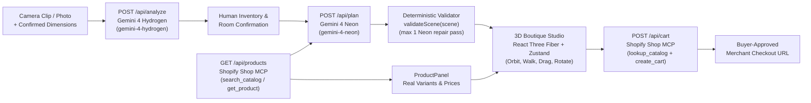

# SpaceStage — Multimodal 3D Retail Layout & Shopify Fixture Studio

**Team SpatioVerse** · Gemini 4 NYC Hackathon (November 21, 2026)  
**Team:** Tilak Bhansali (3D Studio & Frontend) · Akarsh Malik (Gemini 4 Hydrogen/Neon & Constraint Engine) · Mansi Rank (Shopify Shop MCP & Onboarding UI) · Divyansh (Evaluation Suite, Constraint Tests & Documentation)

> **One-Line Pitch:** A small retailer can scan their space, keep the fixtures they already own, preview and rearrange a constraint-checked store in interactive 3D, and buy only the missing pieces from real Shopify merchants without hiring a store designer.

---

## 1. Business Case & Reference Scenario

Independent merchants opening a compact boutique, pop-up shop, or market booth face tight budgets, landlord lease rules (such as no wall drilling), and existing furniture they need to reuse. Ordering new display tables, racks, or lighting without checking physical clearances and total spend leads to costly layout mistakes.

**SpaceStage** bridges raw space capture, deterministic spatial verification, interactive 3D editing, and real commerce:

| Parameter | Reference Demo Scenario (`compactDemoScene`) |
| --- | --- |
| **Store Type** | Compact neighborhood skincare & apothecary boutique |
| **Confirmed Room Envelope** | `12 ft × 10 ft × 9 ft` (`3.6576 m × 3.0480 m × 2.7432 m`), south entrance (`3 ft` / `0.9144 m` wide) |
| **Owned Inventory ($0 spend)** | `1` checkout counter + `1` white oak wall shelf (reused at `$0` toward new-purchase budget) |
| **New-Purchase Budget** | `$400.00` (`40000` cents, excluding shipping/tax) |
| **Hard Physical Constraints** | In-bounds footprint & height, zero rotated-footprint overlaps, `3 ft` (`0.9144 m`) clear entrance/walkway, `noDrilling: true` |
| **Commerce Channel** | Real Shopify catalog search, variant selection, and buyer-approved merchant cart handoff via official Shop MCP |

### Hackathon Alignment
- **Element 119 (Primary):** Multimodal camera input + human-confirmed dimensions → persistent, interactive 3D retail scene (`ShopScene`).
- **Two Separate Gemini 4 Models (Non-Negotiable):** `gemini-4-hydrogen` for multimodal media observation and `gemini-4-neon` for structured spatial layout planning + bounded repair.
- **Shopify Bonus Track (Secondary):** Live product discovery, variant/price inspection, and merchant-specific cart handoff via `https://mcp.shop.com/`.

---

## 2. Architecture & Shared Spatial Contract

All workstreams live in a single **Next.js App Router (TypeScript)** repository and communicate through the shared `ShopScene` contract in [`lib/schema.ts`](lib/schema.ts).



### Non-Negotiable Spatial & Commerce Conventions (`lib/schema.ts`)
- **Units & Axes:** All lengths in **meters** (`FT_TO_METERS = 0.3048`), `Y` is vertical up, and the room floor lies on `X/Z` at `Y = 0` centered at `(0, 0)`:
  - `X ∈ [-room.width / 2, +room.width / 2]` (west → east)
  - `Z ∈ [-room.depth / 2, +room.depth / 2]` (north → south)
  - `Y ∈ [0, room.height]`
- **Object Geometry:** `position: [x, y, z]` (`x, z` footprint center; `y = 0` resting on floor), `size: [width, height, depth]` at `rotationY = 0`, and `rotationY` in counter-clockwise radians around `+Y`.
- **Budget Accounting:** All prices use integer `priceCents`. Objects with `source: 'owned'` always contribute `0` cents toward `budgetCents`.
- **Renderer Isolation:** The React Three Fiber canvas consumes validated `ShopScene` JSON—never raw LLM text. Dragging and rotating fixtures run local deterministic validation at interactive frame rates without calling an AI model.

### Repository File Map

| Path | Role |
| --- | --- |
| `lib/schema.ts` | Canonical Zod & TypeScript contract (`ShopScene`, `SceneObject`, `ProductRef`, `ConstraintIssue`) |
| `fixtures/demoScene.ts` | Offline-ready `flagshipScene` (`24×18 ft`) and `compactDemoScene` (`12×10 ft`) presets |
| `fixtures/eval-cases.json` | `8` independent small-store evaluation scenarios (bounds, collisions, doorway, budget, dimensions, owned reuse, no-drilling, alternate entrance) |
| `app/page.tsx`, `components/SpaceCanvas.tsx`, `components/BoutiqueEnvironment.tsx`, `components/SceneObject.tsx`, `components/FirstPersonRig.tsx`, `components/SceneToolbar.tsx`, `components/MediaIntakeModal.tsx`, `store/useSceneStore.ts` | Interactive 3D boutique editor, GLB/parametric assets, orbit & walkthrough cameras, drag/rotate controls, live constraint outlines |
| `lib/gemini.ts`, `app/api/analyze/route.ts`, `app/api/plan/route.ts` | Server-side `@google/genai` integrations for `gemini-4-hydrogen` and `gemini-4-neon` |
| `lib/constraints.ts` | Deterministic SAT oriented-bounding-box, walkway, no-drilling, dimension-warning & budget validator |
| `lib/shopify.ts`, `app/api/products/route.ts`, `app/api/cart/route.ts` | Server-side Shopify Shop MCP JSON-RPC 2.0 client (`2026-07-28`), catalog normalization & per-merchant cart handoff |
| `components/SetupWizard.tsx`, `components/ProductPanel.tsx` | Controlled camera/file onboarding wizard and live Shopify variant/replacement inspector |
| `tests/constraints.test.ts` | Automated schema & `validateScene` test suite across all `8` scenarios in `fixtures/eval-cases.json` |

---

## 3. Gemini 4 Hydrogen vs. Gemini 4 Neon Roles

SpaceStage uses two distinct Gemini 4 models for separate, auditable responsibilities—never a single monolithic prompt and never silent model substitution:

| System | Model ID / Endpoint | Exact Responsibility | Guardrails |
| --- | --- | --- | --- |
| **Gemini 4 Hydrogen** | `gemini-4-hydrogen` (`POST /api/analyze`) | Multimodal intake of uploaded `JPG`/`PNG`/`WebP` photos or short `MP4`/`WebM` clips (inline `<15 MB` or Google Files API). Extracts candidate owned fixtures (`kind`, `label`, visual cues, rough location, evidence/timestamps) and room cues. | **Never** asserts exact room or furniture dimensions from uncalibrated monocular video; emits explicit measurement warnings for human confirmation. |
| **Gemini 4 Neon** | `gemini-4-neon` (`POST /api/plan`) | Spatial layout planner taking user-confirmed room dimensions, verified/approximate owned fixtures, store purpose/style, `budgetCents`, `minWalkwayWidth`, `noDrilling`, and optional real `ProductRef[]` candidates to produce `ShopScene` JSON. | Preserves owned items when feasible; **never** invents Shopify product IDs or prices; performs at most **1** repair iteration from deterministic `validateScene` issues. |
| **Deterministic Geometry + Three.js** | Local TypeScript (`lib/constraints.ts` / `store/useSceneStore.ts`) | Exact 2D Separating Axis Theorem (SAT) rotated-rectangle overlap, room envelope bounds, `3 ft` entrance/walkway clearance, `noDrilling` check, `UNVERIFIED_DIMENSIONS` warnings, and integer-cent budget enforcement. | Deterministic math—**not** delegated to an LLM. |
| **Shopify Shop MCP** | `https://mcp.shop.com/` (`GET /api/products`, `POST /api/cart`) | Real merchant product discovery, variant lookup, and merchant-specific cart creation. | Not an AI model; never fabricates prices, variants, or checkout links. |

*(Note: Optional `gemini-decision-1` closed-set style selection does not count toward the two-model requirement and is not claimed unless backed by a live API trace.)*

---

## 4. Real Shopify Shop MCP Commerce Flow

Implemented in [`lib/shopify.ts`](lib/shopify.ts), [`app/api/products/route.ts`](app/api/products/route.ts), and [`app/api/cart/route.ts`](app/api/cart/route.ts) over stateless JSON-RPC 2.0 (`MCP-Protocol-Version: 2026-07-28`) against `https://mcp.shop.com/`:

1. **Product Discovery (`GET /api/products?q=...&maxPrice=...`):** Calls `search_catalog` (and `get_product` when inspecting a specific `productId`) and normalizes real variants into `ProductRef` (`title`, `seller`, `sellerDomain`, `productId`, `variantId`, `priceCents`, `currency`, `productUrl`, `imageUrl`, `available`).
2. **Scene Replacement & Budget Tracking:** Selecting a real Shopify variant updates the target `SceneObject` (`source: 'shopify'`, `product: ProductRef`). Owned fixtures remain `$0`; only non-owned `ProductRef` prices count toward `budgetCents`.
3. **Merchant-Grouped Cart Handoff (`POST /api/cart`):**
   - Refreshes live availability, pricing, and canonical URLs via `lookup_catalog`.
   - Groups selected line items by `sellerDomain` (Shopify carts are strictly per-merchant).
   - Calls `create_cart` per merchant to return the merchant's authentic `continue_url` for buyer-controlled review.
   - **Truthful Fallback:** If a merchant restricts anonymous cart creation or lacks a verifiable `sellerDomain`, `/api/cart` returns `cartUrl: null` alongside structured `warnings` and verified external `fallbackProductUrls`—never a fabricated link.
   - **Buyer Control:** `complete_checkout` is intentionally **never** called by SpaceStage.

---

## 5. Installation, Environment Keys & Verification

### Prerequisites
- **Node.js** `20+` (`22+` recommended) and `npm`

### 1. Install Dependencies
```bash
npm install
```

### 2. Configure Server-Side Environment (`.env.local`)
Create `.env.local` in the repository root (never commit `.env*` files, and never prefix secrets with `NEXT_PUBLIC_`):

```bash
# Required for POST /api/analyze (gemini-4-hydrogen) and POST /api/plan (gemini-4-neon)
GEMINI_API_KEY=your_gemini_api_key_here

# Optional: Shopify Shop MCP endpoint override (defaults to https://mcp.shop.com/)
SHOP_MCP_URL=https://mcp.shop.com/

# Optional: Server-side bearer token if using authenticated Shop MCP requests
# Anonymous catalog search and cart creation work without a token.
SHOP_MCP_TOKEN=
```

### 3. Run Development Server, Build & Tests
```bash
# Start interactive 3D studio at http://localhost:3000
# (Renders flagshipScene and compactDemoScene immediately even without API keys)
npm run dev

# Lint and production Next.js build
npm run lint
npm run build

# Run evaluation fixture & constraint tests (Node built-in runner via tsx, or Vitest once merged)
npx --yes tsx --tsconfig tsconfig.json --test tests/constraints.test.ts
# Or, once akarsh_dev's vitest setup is merged into main:
npm test
```

---

## 6. Three-Minute Live Demo Script

1. **`0:00 – 0:30` · Multimodal Space Capture (`gemini-4-hydrogen`):** Upload or record a short `10–20s` clip (or single fallback photo, explicitly noted) of the room and existing furniture. Confirm the `12 × 10 × 9 ft` dimensions, south entrance, and detected owned counter + shelf.
2. **`0:30 – 1:10` · Constraint-Aware Layout Generation (`gemini-4-neon`):** Request a modern minimalist skincare boutique under a `$400` new-fixture budget with `noDrilling: true`. Show structured `ShopScene` JSON preserving owned items at `$0`.
3. **`1:10 – 1:55` · Interactive 3D Manipulation & Live Validation:** Orbit (or enter walkthrough view) in the 3D boutique, select a shelf/rack, rotate it `90°`, and drag it into the `3 ft` south doorway clearance zone to trigger immediate deterministic `BLOCKED_PATH` / `COLLISION` feedback—then drag it back to a valid position.
4. **`1:55 – 2:35` · Live Shopify Discovery & Buyer Handoff:** Select a proposed display table or lamp, inspect live Shop MCP variants, sellers, and prices, swap it into the 3D scene, verify updated budget math, and open the merchant cart (`continue_url`) or verified product page.
5. **`2:35 – 3:00` · Baseline Evaluation & Honest Boundaries:** Present the 8-case deterministic benchmark (`fixtures/eval-cases.json`), baseline vs. validator-verified comparison table, and clear physical/commerce limitations.

---

## 7. Evaluation Benchmark & Baseline Recording Table

Per project rules, **no model output, pass rate, or live trace metric is claimed until backed by an actual recorded trace on the integrated branch.**

### 7A. Synthetic Constraint Suite (`fixtures/eval-cases.json` + `tests/constraints.test.ts`)

Covers `8` independent small-store test cases in centered meters (`eval-01-fits`, `eval-02-collisions`, `eval-03-blocked-entrance`, `eval-04-reduced-budget`, `eval-05-missing-dimensions`, `eval-06-reused-owned-fixture`, `eval-07-no-drilling-violation`, `eval-08-alternate-entrance`):

| Suite | Branch / Target | Cases | Passed | Failed | Explicit `TODO` | Run Time | Notes |
| --- | --- | --- | --- | --- | --- | --- | --- |
| `tests/constraints.test.ts` (`fixtures/eval-cases.json` + presets) | `main` (Vitest) | `13` (`2` schema + `8` scenarios + `3` boundary/preset) | `13` | `0` | `0` | `~734 ms` (full `npm test`) | Verifies `ShopSceneSchema`, `$0` owned budget math, `validateScene`, and `evaluateScene` |
| Full Repository Automated Suite (`npm test`) | `main` (`3` test files) | `30` (`tests/constraints.test.ts` + `lib/constraints.test.ts` + `app/api/analyze/analyze.test.ts`) | `30` | `0` | `0` | `734 ms` | Measured via `vitest run` on integrated `main` |

### 7B. End-to-End Model & Commerce Evaluation (Fill Only From Real Traces)

| Metric | Baseline (Single `gemini-4-neon` Call, No Validator Repair) | Full Pipeline (`gemini-4-hydrogen` + `gemini-4-neon` + `validateScene` + 1 Repair) | Verification Method |
| --- | --- | --- | --- |
| **Constraint Pass Rate** (`8` held-out prompts) | `TO MEASURE` | `TO MEASURE` | Deterministic `validateScene(scene)` check (`0` error-severity issues) |
| **Owned Fixture Retention** | `TO MEASURE` | `TO MEASURE` | Audit confirmed `source: 'owned'` IDs preserved in returned `ShopScene` at `$0` |
| **Valid Merchant Cart / Product Handoff** | `TO MEASURE` | `TO MEASURE` | Live Shop MCP `search_catalog` / `create_cart` HTTP responses only |
| **Unknown-Dimension Warning Coverage** | `TO MEASURE` | `TO MEASURE` | Verify `dimensionsVerified: false` items emit `UNVERIFIED_DIMENSIONS` warning |
| **Median End-to-End Latency** | `TO MEASURE` | `TO MEASURE` | Wall-clock server trace (`x-request-id` logs for `/api/analyze` + `/api/plan`) |

---

## 8. Known Failures & Truthful Limitations

1. **No Uncalibrated Centimeter Reconstruction:** Casual monocular phone videos and photos lack metric scale calibration. SpaceStage uses camera media strictly for visual inventory and scene context; the shop owner must confirm room dimensions (`width`, `depth`, `height`, `entrance`), and unverified object sizes emit `UNVERIFIED_DIMENSIONS` warnings rather than silent passes.
2. **Illustrative 3D Geometry vs. Physical Specs:** Generic parametric meshes and bundled GLB assets (`chair.glb`, `lamp.glb`, `plant.glb`, `vase.glb`) represent fixtures visually in 3D. Physical clearance accuracy depends on matching `SceneObject.size` to verified merchant specifications.
3. **Geometric & Budget Rules — Not Building-Code Certification:** The constraint validator checks room bounds, 2D rotated-rectangle + vertical overlaps, a `3 ft` (`0.9144 m`) entrance/walkway rule, `noDrilling` mounting heuristics, and integer-cent purchase budgets. It does **not** certify ADA accessibility, fire egress, structural load, or municipal building codes.
4. **Merchant-Specific Shopify Carts:** Cross-merchant selections cannot be combined into a single Shopify cart URL; `/api/cart` groups items by `sellerDomain` into separate merchant handoffs. Where individual merchants block anonymous MCP cart creation, SpaceStage explicitly reports the limitation and provides the verified `productUrl`.

---

## 9. Official References

- **Gemini 4 Hydrogen Model Card:** https://deepmind.google/models/model-cards/gemini-4-hydrogen/
- **Gemini 4 Neon Model Card:** https://deepmind.google/models/model-cards/gemini-4-neon/
- **Gemini Interactions API:** https://ai.google.dev/gemini-api/docs/interactions
- **Gemini Decisions API:** https://blog.google/innovation-and-ai/technology/developers-tools/gemini-decisions-api/
- **Shopify Shop MCP Documentation:** https://shopify.dev/docs/agents/shop-mcp
- **Shop Checkout Documentation:** https://shop.dev/docs/checkout
