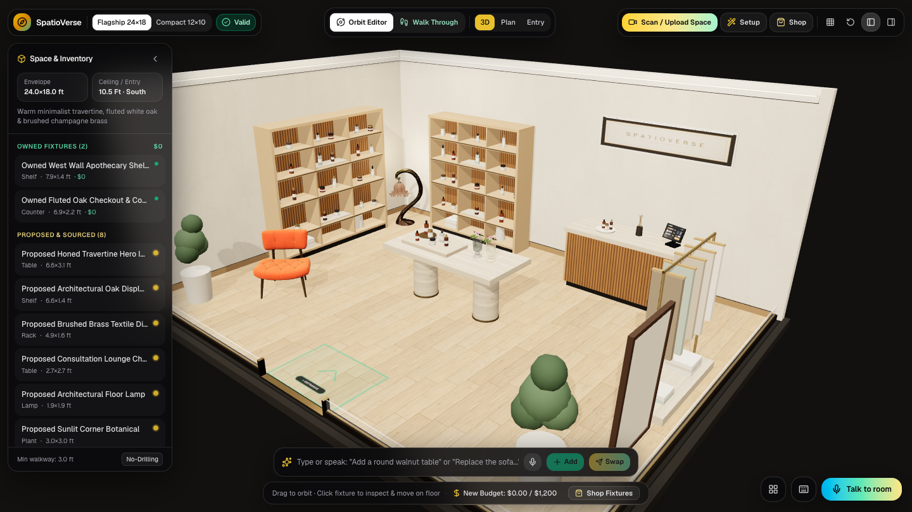
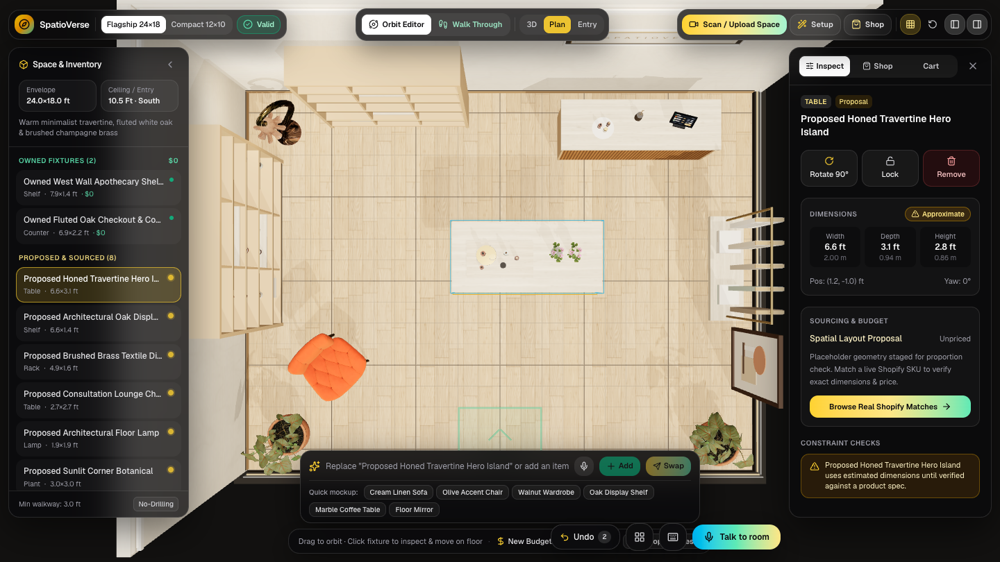
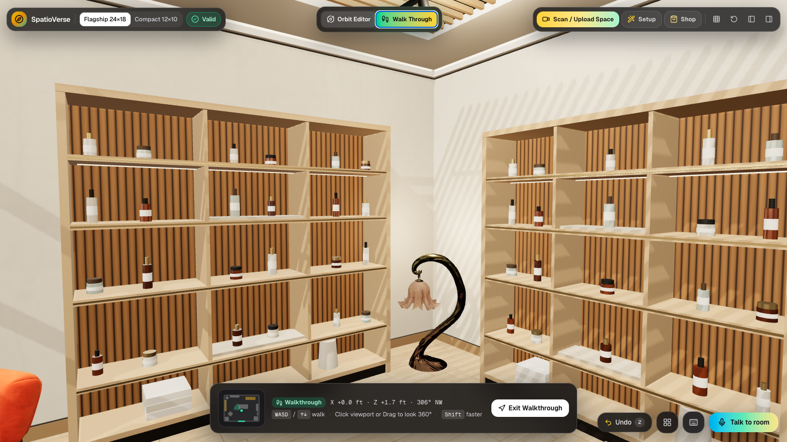
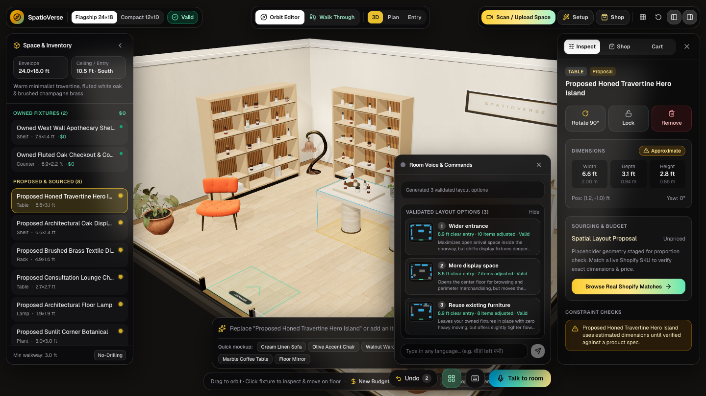
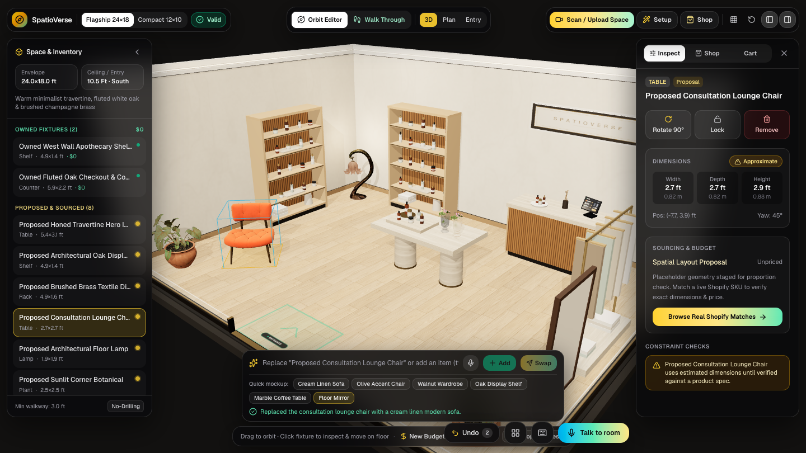
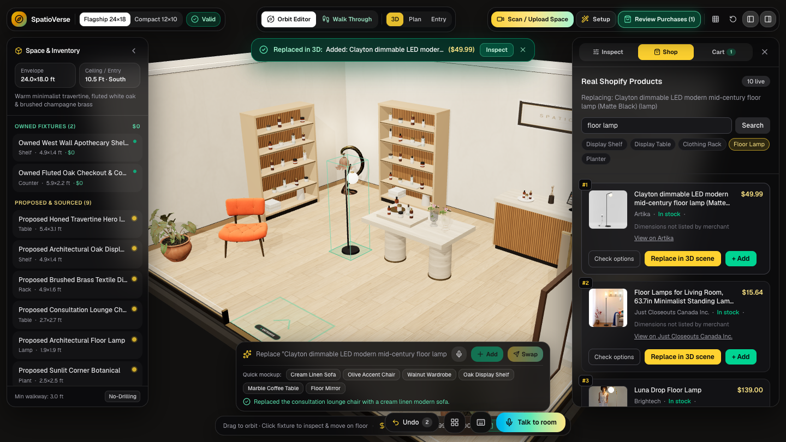
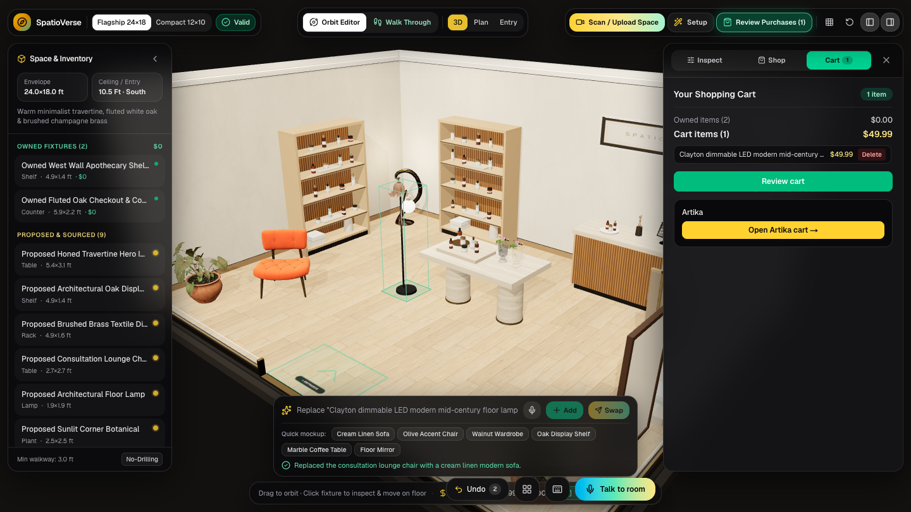
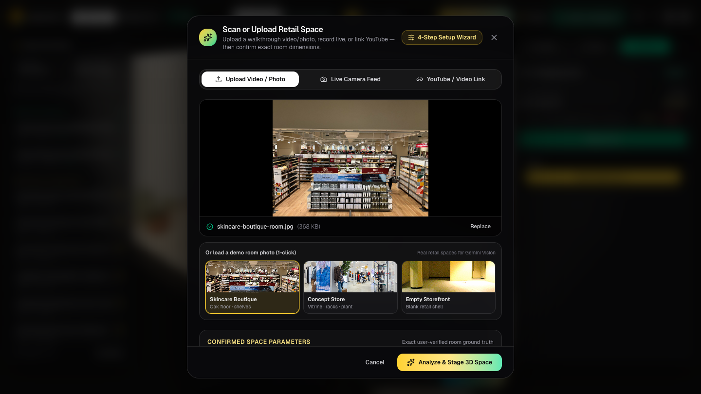
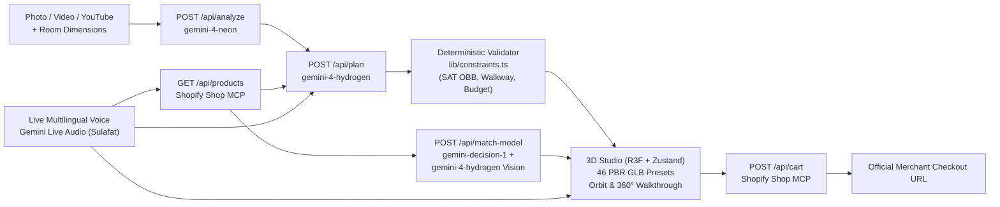

# SpatioVerse

**Multimodal 3D Room & Retail Layout Studio powered by Gemini 4, Decisions API, Gemini Live Audio, and Shopify Shop MCP.**

[](https://nextjs.org/)
[](https://docs.pmnd.rs/react-three-fiber)
[](https://ai.google.dev/)
[](https://mcp.shop.com/)
[](./tests)
[](https://youtu.be/JetuxNmiOb0)

SpatioVerse turns room photos, walkthrough videos, or YouTube clips into an interactive, constraint-checked 3D retail and interior studio. Keep owned furniture at **`$0`**, explore in **360° First-Person Walkthrough**, rearrange rooms with **live multilingual voice (`Sulafat`)** or quick AI mockups, source **real live Shopify products** visually matched to **46 PBR 3D `.glb` assets**, and generate **buyer-approved merchant checkout carts**.



## Demo Walkthrough Video

Watch the full end-to-end live walkthrough on YouTube (3D orbit & plan views, 360° first-person walkthrough with minimap, multi-layout advisor, Gemini 4 AI fixture swap, live Shopify photo-to-3D matching, merchant cart checkout, and multimodal room upload):

[](https://youtu.be/JetuxNmiOb0)

**[▶ Watch Full Walkthrough Video on YouTube](https://youtu.be/JetuxNmiOb0)**

---

## Visual Feature Tour

### 1. Interactive 3D Studio, Floor Grid & Architectural Viewpoints
Switch seamlessly between **Flagship 24×18 ft** and **Compact 12×10 ft** presets, toggle **3D / Plan / Entry** camera viewpoints, overlay the **1-ft architectural floor grid**, and inspect exact dimensions, coordinates, and live constraint status (`Valid` / `OUT_OF_BOUNDS` / `COLLISION` / `BLOCKED_PATH`).

| Architectural Top-Down Plan & Grid | First-Person 360° Walkthrough + Live Minimap |
| --- | --- |
|  |  |

- **Orbit Editor:** Click to select, drag on the floor plane with 2 cm snapping, rotate 90°, lock in place, or remove any fixture.
- **360° Walk Through:** Navigate inside your staged space at eye level (`WASD` / arrow keys + mouse look + collision sliding) with a live 2D mini-floorplan and compass HUD.

---

### 2. Live Multilingual Voice Editor & Multi-Layout Room Advisor
Powered by **Gemini Live Audio (`Sulafat` voice)** with a full typed multilingual fallback (English, Hindi, Hinglish, and more):

| Multi-Layout Room Advisor & Voice Panel | AI Quick Mockup & Inspector |
| --- | --- |
|  |  |

- **Validated Multi-Layout Suggestions:** Click the layout icon or ask *"Show me a few ways to arrange this room"* to generate up to 3 validated, genuinely distinct room layouts (`Wider entrance`, `More display space`, `Reuse existing furniture`) with live mini-floorplans and translucent 3D previews.
- **Precision Voice & Prompt Editing:** Say *"Move the counter slightly left"*, *"Rotate the rack sideways"*, *"Undo"*, or use the bottom **Swap / + Add** bar (`POST /api/replace`) to instantly place or swap 3D furniture mockups.
- **Consultative Redesign:** Ask *"Redesign my room minimalist under \$800"* to combine live in-budget Shopify sourcing with constraint-validated layout planning.

---

### 3. Live Shopify Catalog, Vision-to-3D Matching & Dedicated Cart Checkout
Dedicated **`Inspect | Shop | Cart`** tabs separate browsing, staging, and purchasing cleanly:

| Live Shopify Catalog & Photo-to-3D Match | Dedicated Cart & Real Merchant Checkout |
| --- | --- |
|  |  |

- **Live Shopify Shop MCP Search (`GET /api/products`):** Search real merchants, live prices, stock status, and product variants directly from `https://mcp.shop.com/`.
- **Atomic Photo-to-3D Matching (`POST /api/match-model`):** Clicking **`+ Add`** or **`Replace in 3D scene`** uses `gemini-decision-1` + `gemini-4-hydrogen` Vision to inspect the real product photo, select the closest of **46 CC0 PBR `.glb` models** (or bespoke architectural lamps), sample its finish color, and normalize proportions to the room.
- **Truthful Cart & Checkout (`POST /api/cart`):** Owned items stay **`$0.00`**. Locking or adding Shopify items populates the dedicated **`Cart`** tab with per-item controls, live subtotal, and real per-merchant checkout links (`Open <Seller> cart →`)—never fabricated prices or unauthorized orders.

---

### 4. Multimodal Space Capture & 1-Click Sample Retail Rooms
Upload a storefront photo or walkthrough clip, record directly from a live camera, paste a YouTube walkthrough link, or test instantly with **3 built-in real retail room photos** (`public/samples/`):



- **`POST /api/analyze` (`gemini-4-neon`):** Extracts visible owned fixtures, material/mounting cues, and explicit scale-uncertainty warnings from images, videos (inline ≤14 MB or Gemini Files API), or YouTube URLs.
- **`POST /api/plan` (`gemini-4-hydrogen`):** Plans a constraint-validated 3D layout around your confirmed room dimensions (`width × depth × height`), entrance wall, budget, and `noDrilling` rule—with an automatic 1-pass deterministic repair loop if any constraint is violated.

---

## Architecture & Gemini Model Stack

SpatioVerse separates multimodal perception, structured spatial planning, calibrated 3D asset matching, real-time voice interaction, deterministic geometry validation, and live commerce through a single Zod-validated `ShopScene` contract (`lib/schema.ts`).



| Layer | Model / Service | Endpoint | Responsibility |
| --- | --- | --- | --- |
| **Multimodal Space Intake** | `gemini-4-neon` | `POST /api/analyze` | Analyzes uploaded `JPG`/`PNG`/`WebP`/`MP4`/`MOV`/`WebM` media (inline ≤14 MB or Gemini Files API) or YouTube URLs to extract existing fixtures and spatial cues. |
| **Layout Planning & Swap Engine** | `gemini-4-hydrogen` | `POST /api/plan`, `POST /api/replace` | Generates constraint-checked `ShopScene` layouts (with max-1 repair pass), executes text/voice add & replace commands, and powers full-room style/budget redesigns. |
| **Product Image → 3D Asset Matcher** | `gemini-decision-1` + `gemini-4-hydrogen` Vision | `POST /api/match-model` | Uses `v1beta/decisions` (`gemini-decision-1`) for calibrated category routing, then `gemini-4-hydrogen` Vision to match the product photo to 46 PBR `.glb` presets and sample color/albedo. |
| **Live Multilingual Voice Partner** | `gemini-3.1-flash-live-preview` (`Sulafat`) | `POST /api/voice/token`, `POST /api/voice/command` | Real-time bidirectional voice (English, Hindi, Hinglish, and more) with translucent 3D previews, multi-layout suggestions, Shopify browsing, cart management, and order receipts. |
| **Deterministic Constraint Engine** | Pure TypeScript (`lib/constraints.ts`) | Client + Server | Exact 2D Separating Axis Theorem (SAT) rotated-OBB collisions, room bounds, 3 ft (`0.9144 m`) doorway & BFS walkway clearance, `noDrilling`, and integer-cent budget checks. |
| **Live Commerce** | Shopify Shop MCP (`https://mcp.shop.com/`) | `GET /api/products`, `POST /api/cart` | Live catalog search, variant inspection, and per-merchant cart creation (`MCP-Protocol-Version: 2026-07-28`). |

---

## Local Setup & Running

### Prerequisites
- **Node.js** `20+` (`22+` recommended)
- **npm** `10+`
- A Google Gemini API key with access to Gemini 4 and Gemini Live models

### 1. Install Dependencies
```bash
npm install
```

### 2. Configure Environment Variables
Copy `.env.example` to `.env.local` and set your server-side API key (never commit `.env.local` or expose secrets with `NEXT_PUBLIC_`):

```bash
cp .env.example .env.local
```

```env
# Required — used server-side by /api/analyze, /api/plan, /api/replace, /api/match-model, and /api/voice/*
GEMINI_API_KEY=your_gemini_api_key_here
```

### 3. Run the Development Server
```bash
npm run dev
```
Open `http://localhost:3000`. Two offline-ready demo scenes (`Flagship 24×18` and `Compact 12×10`) plus 3 built-in sample room photos load immediately without requiring an external upload.

### 4. Production Build & Start
```bash
npm run build
npm run start
```

---

## Verification & Testing

Run TypeScript verification, ESLint, and the automated Vitest suite (**40/40 passing tests** across spatial constraints, Gemini API contracts, and voice editing):

```bash
npx tsc --noEmit
npm run lint
npm test
```

| Test Suite | Tests | Coverage |
| --- | :---: | --- |
| `lib/constraints.test.ts` | 10 | Core deterministic geometry, SAT rotated-OBB collisions, walkway BFS, budget & no-drilling checks |
| `tests/constraints.test.ts` | 13 | End-to-end small-store evaluation scenarios from `fixtures/eval-cases.json` |
| `app/api/analyze/analyze.test.ts` | 9 | `/api/analyze` (inline, Files API, YouTube), `/api/plan` (1-pass repair), and `/api/replace` contracts |
| `tests/voice-editing.test.ts` | 8 | Camera-relative moves, wall alignment, stale-epoch guards, multi-layout previews, and undo stack |

---

## API Reference

| Route | Method | Description |
| --- | --- | --- |
| `/api/analyze` | `POST` | Multimodal media intake (`multipart/form-data` or YouTube JSON) via `gemini-4-neon` |
| `/api/plan` | `POST` | Constraint-validated `ShopScene` planner with max-1 repair pass via `gemini-4-hydrogen` |
| `/api/replace` | `POST` | Natural-language / voice 3D object add, replace, or remove via `gemini-4-hydrogen` |
| `/api/match-model` | `POST` | Product image → 46-asset `.glb` & dominant color matcher via `gemini-decision-1` + `gemini-4-hydrogen` |
| `/api/voice/token` | `POST` | Issues short-lived ephemeral auth tokens for Gemini Live Audio sessions |
| `/api/voice/command` | `POST` | Typed multilingual voice-command fallback returning structured `VoiceAction[]` |
| `/api/products` | `GET` | Live Shopify Shop MCP catalog search (`?q=...&maxPrice=...`) and variant lookup (`?productId=...`) |
| `/api/cart` | `POST` | Per-merchant Shopify cart creation (`lookup_catalog` + `create_cart`) with truthful fallback URLs |

---

## Repository Structure

```text
app/
  page.tsx                       # Main 3D Studio, Inspect | Shop | Cart drawer & HUD
  api/
    analyze/route.ts             # gemini-4-neon media analysis
    plan/route.ts                # gemini-4-hydrogen layout planner + repair
    replace/route.ts             # gemini-4-hydrogen add/replace/remove engine
    match-model/route.ts         # gemini-decision-1 + Vision GLB matcher
    voice/token/route.ts         # Ephemeral Gemini Live token endpoint
    voice/command/route.ts       # Typed multilingual voice fallback
    products/route.ts            # Shopify Shop MCP catalog search
    cart/route.ts                # Shopify Shop MCP per-merchant cart handoff
components/
  SpaceCanvas.tsx                # React Three Fiber canvas, lighting, camera & voice previews
  SceneObject.tsx                # 46-model GLB renderer, auto-axis alignment & color tinting
  BoutiqueEnvironment.tsx        # Room shell, flooring, entrance decal & floor grid
  FirstPersonRig.tsx             # 360° Walkthrough camera controller with collision sliding
  MediaIntakeModal.tsx           # Photo / video / camera / YouTube intake + 1-click samples
  SetupWizard.tsx                # 4-step guided room & inventory wizard
  ProductPanel.tsx               # Live Shopify browser, dedicated Cart tab & checkout cards
  ReplaceObjectBar.tsx           # Prompt & voice add/swap bar
  VoiceRoomControl.tsx           # Live multilingual voice HUD & multi-layout preview controls
lib/
  schema.ts                      # Canonical Zod & TypeScript ShopScene contract
  constraints.ts                 # Deterministic SAT, walkway BFS, budget & no-drilling validator
  gemini.ts                      # Server-side Gemini 4 & Decisions API orchestration
  modelCatalog.ts                # 46 CC0 PBR GLB asset registry
  roomProportions.ts             # Per-furniture realistic room-scale normalization & dedupe
  shopify.ts                     # Shopify Shop MCP JSON-RPC 2.0 client
  voiceActions.ts                # VoiceAction schemas & multilingual system prompt
  voiceExecutor.ts               # Deterministic + async voice tool executor
  voiceLiveClient.ts             # Gemini Live WebSocket audio & tool-call client
  layoutSuggestions.ts           # Multi-layout generator & proactive room advisor
store/
  useSceneStore.ts               # Zustand scene, undo stack, voice preview & cart state
public/
  models/                        # 46 CC0 PBR .glb furniture assets
  samples/                       # 3 ready-to-use real retail room photos for 1-click demos
docs/
  screenshots/                   # Curated HD screenshots embedded in this README
fixtures/                        # Offline demo scenes & 8 constraint eval cases
tests/                           # Vitest constraint & voice editing suites
```

---

## Engineering Guardrails

- **Spatial Honesty:** Uncalibrated single-camera video/photos cannot yield millimeter-exact dimensions; `/api/analyze` flags approximate measurements (`UNVERIFIED_DIMENSIONS`) until confirmed by the user.
- **Deterministic Geometry:** Bounds, rotated-OBB collisions, 3 ft walkway clearances, and budget totals are computed in local TypeScript (`lib/constraints.ts`)—never delegated to an LLM.
- **Buyer-Controlled Commerce:** SpatioVerse never fabricates product IDs, prices, or checkout links, and never auto-completes checkout (`complete_checkout` is intentionally unused); all orders hand off to official merchant carts for buyer review.

---

## Team SpatioVerse

Built for the **Gemini 4 NYC Hackathon (November 21, 2026)** by **Tilak Bhansali**, **Akarsh Malik**, **Mansi Rank**, and **Divyansh**.
